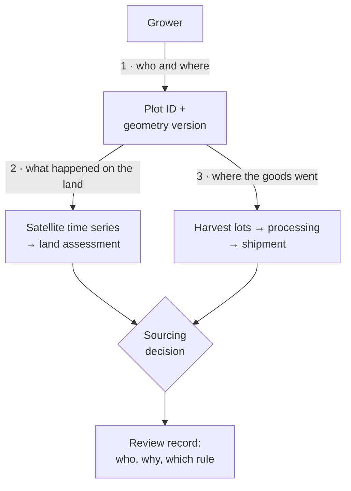
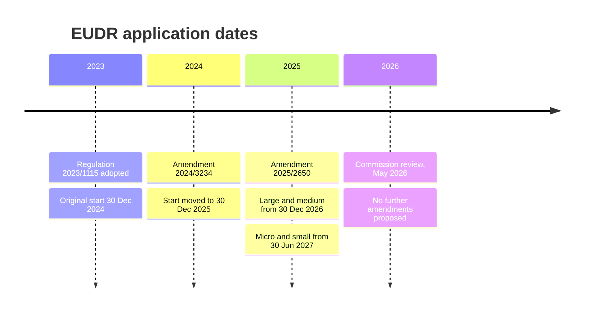
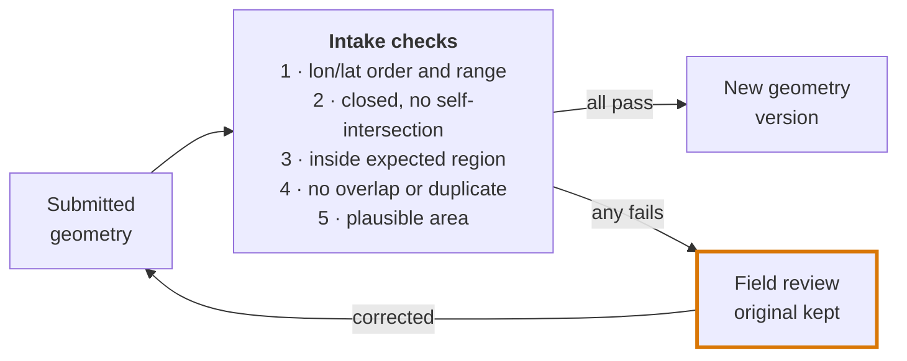
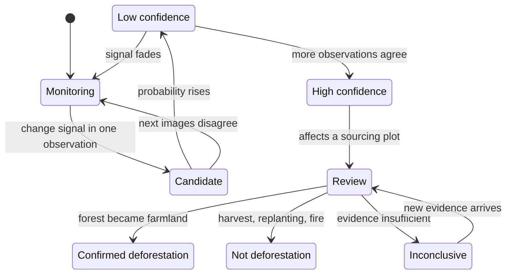
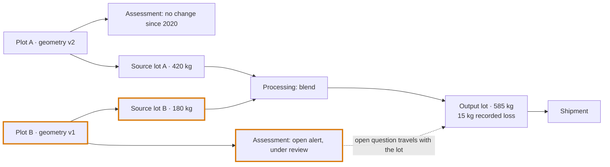
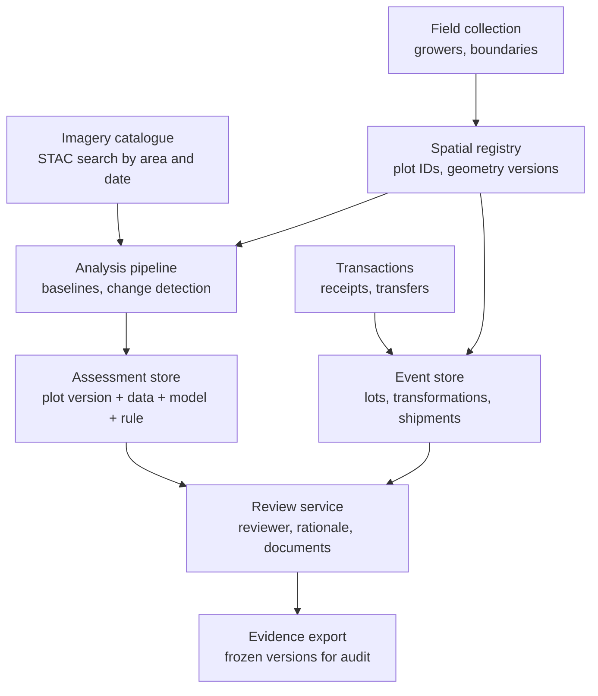

Imagine a container of natural rubber leaving Kochi for a tyre factory in Europe. The paperwork is spotless. Every purchase is recorded, every bale is weighed, every transfer is signed.

Now imagine three ways it can still be wrong:

- The farm polygon behind one of those purchases sits 15 metres from the real farm, because the boundary was walked with a phone under a thick canopy.
- The polygon is right, but a satellite flagged a clearing there in 2022, and nobody knows whether that was forest being cut or an old rubber block being replanted.
- Both of those are fine, but at the processing plant the rubber was blended with material from a plot nobody has checked.

None of these failures shows up if you look at only one system. The transaction ledger looks complete. The map looks precise. The satellite model did its job. The problem lives in the gaps between them.

That gap is what **geospatial traceability** is about. It connects where something was produced, what happened on that land over time, and how the product moved through the supply chain. This post is my attempt to explain how it actually works, where it breaks, and how I would test whether a system is any good.

> **What this is (and isn't).** This is a technical review of public product documentation, open datasets, standards, regulation, and peer-reviewed research, with sources checked on 18 October 2026. Company descriptions are what each company says about itself; I haven't benchmarked any of them. The architecture and test plan near the end are my proposals. No field experiment is reported here.

## The short version

If you only read one section, read this:

1. **A credible system keeps three links intact:** grower to plot, plot to its land history, and plot to shipment. Each link carries its own uncertainty, and stacking them doesn't cancel it out.
2. **The boundary is the first failure point.** A 10 m GPS error can move a meaningful share of a small farm out of its own polygon before any satellite is involved.
3. **Coordinate precision is not accuracy.** EUDR asks for six decimal places, about 10 cm. A phone under canopy is typically off by metres.
4. **Tree-cover loss is not deforestation.** A satellite can see canopy disappear. Deciding whether that was deforestation needs land-use context and a rule.
5. **"Inconclusive" is a valid answer.** The best open tools say "more info needed" rather than guessing, especially for shade-grown coffee and agroforestry.
6. **A blended batch inherits every open question.** One clean plot can't vouch for another one in the same lot.

## 1. What makes traceability "geospatial"?

Ordinary traceability asks where a product came from and how it moved. Geospatial traceability adds two things: **a production unit with an explicit location and shape**, and **a time-dependent record of what happened on that land**.

I find it helpful to think of it as three chains that meet at a decision:

Each box is a record that has to survive. If any arrow is missing, the decision at the end rests on an assumption, not evidence.

| Evidence layer | The question it answers |
| --- | --- |
| Production identity | Which holding produced this material? |
| Environmental history | What happened on this land, and when? |
| Material provenance | How did that production end up in this shipment? |
| Decision history | Why was the evidence accepted, and under which rule? |

## 2. Why this matters now: EUDR in late 2026

The EU Deforestation Regulation, (EU) 2023/1115, is the clearest real-world driver. It covers cattle, cocoa, coffee, oil palm, rubber, soya, and wood. To be sold in the EU, these products must come from land that hasn't been deforested after **31 December 2020**. [EUDR, Regulation (EU) 2023/1115](https://eur-lex.europa.eu/eli/reg/2023/1115/oj)

The start date has moved twice. After the latest amendment, Regulation (EU) 2025/2650, the rules apply to large and medium operators from **30 December 2026** and to micro and small operators from **30 June 2027**. [Regulation (EU) 2025/2650](https://eur-lex.europa.eu/eli/reg/2025/2650/oj), [European Commission: EUDR overview](https://environment.ec.europa.eu/topics/forests/deforestation/regulation-deforestation-free-products_en)

The 2025 amendment also changed who does the paperwork. Due diligence now sits with the first operator placing the product on the EU market. Downstream operators and traders no longer file their own statements. The Commission's May 2026 review concluded that it did not consider further amendments to the basic text appropriate. [Commission report on the EUDR simplification review, May 2026](https://environment.ec.europa.eu/document/download/a3c5c3a0-232e-43c4-b0b8-1eecb1df45c7_en?filename=Report+from+the+Commission+to+the+Council+and+Parliament+on+the+EUDR.pdf)

Two details matter a lot for a GIS engineer:

- **The geolocation rule.** The regulation asks for coordinates with at least six decimal digits. One point is enough for a plot of four hectares or less. Larger plots (other than cattle) need a polygon. [EUDR Article 2(28)](https://eur-lex.europa.eu/eli/reg/2023/1115/oj)
- **Country risk.** The Commission's 2025 benchmarking lists only Belarus, North Korea, Myanmar, and Russia as high risk. **India is classified as low risk.** Brazil, Indonesia, Malaysia, and Côte d'Ivoire remain standard risk. [Implementing Regulation (EU) 2025/1093](https://eur-lex.europa.eu/eli/reg_impl/2025/1093/oj)

India's low-risk status interacts with the 2025 amendment. Micro and small *primary* operators in low-risk countries, meaning growers placing their own produce on the market, can file a one-time simplified declaration. They may even give a postal address instead of plot coordinates. [Regulation (EU) 2025/2650](https://eur-lex.europa.eu/eli/reg/2025/2650/oj) That lowers the legal burden for many Indian smallholders. In my view it doesn't lower the engineering bar for a buyer who wants to *know* where their material came from. A postal address can't be checked against a satellite time series.

The regulation is one application, not the whole subject. The broader question outlasts any law: **can a buyer reconstruct the evidence behind a sourcing decision?** Dates and scope can still change, so check the official sources before relying on any of them.

## 3. How six companies approach the problem

The companies I looked at start from different places, and their features increasingly overlap. Here is what each one publicly emphasises.

| Company | Starting point | What stands out |
| --- | --- | --- |
| LiveEO (TradeAware) | Satellite analysis | Compliance workflow and enterprise integration |
| TRST01 | Field and farmer data | Drones, field visits, batch tracking |
| Satelligence | Change detection | Unusually open about its methods |
| Airbus + Earthworm (Starling) | Monitoring | Turning alerts into supplier engagement |
| Space Intelligence | Land-cover mapping | Local ecological calibration |
| Koltiva (KoltiTrace) | Producer records | Transactions and farm management |

### LiveEO: assessment inside the business workflow

TradeAware pairs what LiveEO calls a proprietary satellite-AI engine, marketed as Precision Analytics, with supplier data collection, legal review through the law firm CMS, ERP integration, and submissions to the EU's TRACES system. LiveEO says it reaches an "effective resolution of 5m" through a spatio-temporal combination of data sources, which the page doesn't name. [LiveEO TradeAware](https://www.live-eo.com/product/tradeaware) In September 2026 it added a self-service Professional tier. [LiveEO press release](https://www.live-eo.com/company/press/liveeo-launches-tradeaware-professional-self-service)

My takeaway is that a map is only useful if it plugs into procurement. If plot IDs can't be joined to orders and suppliers, a perfect assessment just sits there. The public material doesn't reveal enough to reproduce the model or judge how it performs on, say, a half-hectare plot in Kerala.

### TRST01: from the field upward

TRST01 describes capturing "every farmer, plot polygon and land document" once, then tracking purchases, transfers, and processing batch by batch. It says field teams walk farm boundaries with GPS apps, it runs its own drone fleet, and it combines that with satellite time series and its own deforestation analysis. Plots that can't be resolved are "flagged for drone verification or a field visit." [TRST01 methodology](https://trst01.com/blogs/traceability-you-can-trust)

This is a good example of mixing evidence from different scales. A drone flight shows you today's boundary and land cover in fine detail. It can't tell you what the land looked like in 2020; only historical satellite imagery can. I'd want to know what the rules are when the two disagree.

### Satelligence: showing its working

Satelligence names its inputs (Sentinel-1, Sentinel-2, Landsat, and PlanetScope) and its methods: Random Forest and Gradient Boosting for classification, deep learning to clean radar noise, and what it calls Bayesian Iterative Updating to track change over time. [Satelligence FAQ](https://satelligence.com/faq/) That's far more detail than most commercial pages give.

A 2020 explainer describes the core idea: probabilities from successive observations are stacked, so a pixel can be flagged as possibly deforested and then confirmed or rejected by later images. [Satelligence, 2020](https://satelligence.com/how-we-detect-deforestation-using-satellite-data/) It's an older post, so I treat it as an explanation of the approach, not proof of what runs in production today.

The lesson I take is that **"first suspicious" and "confirmed" are two different dates.** A system should store both. That's how you measure detection delay and reason about events close to a cut-off.

### Starling: alerts that lead somewhere

Airbus describes Starling, built with Earthworm Foundation since 2016, as combining its own land-cover maps, deforestation alerts, plot validity and status checks, and delivery via a platform, API, or reports. Imagery ranges from 10 m down to 30 cm from Pléiades Neo. [Airbus Starling](https://www.space-solutions.airbus.com/industries/forest-and-environment/starling/)

The design pattern is assessment followed by action. The interesting questions are operational: how does an alert become a supplier conversation, and does the final outcome stay linked to the original alert? A 30 cm image doesn't answer that by itself.

### Space Intelligence: maps tuned to place

Space Intelligence describes calibrating its maps with ecologists, accounting for seasonality and cloud cover, and classifying 10 m pixels into more than just forest and non-forest, including agriculture and tree crops. It calls itself the exclusive geospatial mapping partner for ICE's Commodity Traceability platform. [Space Intelligence](https://www.space-intelligence.com/land-cover-mapping/)

This is the modular model: a specialist mapper feeds evidence into someone else's traceability system. The hard part becomes the handover. Do the class definitions, observation dates, uncertainty, and map version travel with the result?

### Koltiva: the records that make maps useful

KoltiTrace covers farmer profiles, polygon mapping of farms, verified digital transactions, supply-chain mapping, and historic land-use-change emissions, alongside farm management and producer engagement. [Koltiva KoltiTrace](https://www.koltiva.com/koltitrace)

This exposes a dependency people often skip. **Satellites can't recover a purchase record that was never written down.** If a collector logs only a supplier's name while mixing produce from several farms, no amount of imagery will rebuild those links with confidence.

### The open toolkit

Two open efforts deserve a mention because they publish their logic.

**Whisp** ("What is in that plot?"), from the Forest Data Partnership with FAO involvement, applies a "convergence of evidence" approach. It runs a plot against many datasets, including JRC forest maps, Hansen tree-cover loss, and the GLAD and RADD alerts, and reports how they agree. It's open source and says plainly that "no single source of geospatial data can tell the whole story." For coffee or cocoa grown under shade, it may return **"More info needed."** [Whisp on GitHub](https://github.com/forestdatapartnership/whisp)

**Global Forest Watch's integrated alerts** merge several alert systems. An alert reaches "highest" confidence only when multiple systems detect a disturbance in the same pixel. [Global Nature Watch: integrated alerts](https://globalnaturewatch.org/blog/data-and-tools/integrated-deforestation-alerts)

Neither tool is a compliance verdict. Both show what transparent decision rules look like, which makes them a useful reference point when judging a closed product.

**What I'm not claiming:** public pages are enough to compare *approaches*. They're not enough to rank anyone's *accuracy*. I've deliberately avoided a league table.

## 4. The first GIS problem is the boundary

Before running any model, I'd look hard at the polygon. An analysis can be mathematically perfect and still describe the wrong piece of land.

### Precision versus accuracy

EUDR asks for six decimal places. RFC 7946, the GeoJSON spec, notes that six decimal places is about 10 centimetres. [RFC 7946](https://www.rfc-editor.org/rfc/rfc7946.html)

Now compare that with the device that usually records the boundary. A 2022 study of smartphones under forest canopy measured positioning errors of roughly **4.6 to 14.6 metres**. It also found accuracy varies greatly even between identical phone models. [Purfürst, Sensors 2022](https://pmc.ncbi.nlm.nih.gov/articles/PMC8838512/)

So a coordinate can carry 10 cm of *precision* and 10 m of *error*. The format can't tell you which.

### What that error does to a small farm

Here's a hypothetical to make it concrete. Take a square one-hectare plot, 100 m on a side, and shift the polygon 10 m east:

- 1,000 m² of the real farm, **10%**, now falls outside its own polygon.
- For a half-hectare plot (about 71 m on a side), the same shift misplaces about **14%**.

Pixels make it worse. Lay that one-hectare square on a 10 m grid that's offset by half a pixel. It touches 121 pixels, but only 81 are fully inside the farm. The other 40 mix farm and neighbouring land. On a 30 m grid with the same offset, it touches 16 pixels, and **only 4 sit entirely inside**.

The numbers are illustrative, but the pattern is real. Research on smallholder field delineation in India found that with 4.8 m PlanetScope imagery, high average accuracy was only reached for fields larger than about one hectare. [Wang, Waldner & Lobell, Remote Sensing 2022](https://doi.org/10.3390/rs14225738) For smallholdings, **boundary quality can dominate the result** even when the imagery is fine.

### Points are legal; polygons are better

Under EUDR, a plot of four hectares or less can be described by a single point. That's legally fine, but a point says nothing about where the boundary is. In the EU system, a point submitted without an area is assigned a default of four hectares. [EUDR Information System: GeoJSON description](https://eudr.webcloud.ec.europa.eu/tracesnt/help/eudr-documentation/operator/geojson-description.html)

If I'm running land-history analysis, I want a polygon whenever it can reasonably be collected, even when the law allows less. India's Coffee Board draft sustainability standard follows the regulation's split: a sketch with a single coordinate for farms up to four hectares, a polygon above that. [Coffee Board of India, draft INDICOFS standard, 2025](https://coffeeboard.gov.in/Indian%20Coffee/Draft%20Sustainability%20Standards%20for%20Indian%20CoffeeOpen%20for%20stakeholder%20Consultation%20and%20Feedback.pdf)

### The intake checks I'd run

The EU system already rejects a lot. It accepts only Points, MultiPoints, Polygons, and MultiPolygons, in WGS 84. It rejects holes and self-intersections, truncates coordinates to six decimals, and caps files at 25 MB. [EUDR GeoJSON description](https://eudr.webcloud.ec.europa.eu/tracesnt/help/eudr-documentation/operator/geojson-description.html) ICE's plot validation goes further, testing for overlaps, duplicates (under the same or a different farmer ID), unclosed polygons, and points with implausible sizes. [ICE farm plot data tests](https://www.ice.com/iba/commodity-traceability-service/farm-plot-data)

My proposed intake pipeline looks like this:

A few implementation notes from the standards:

- **Axis order is a classic trap.** GeoJSON uses longitude then latitude. [RFC 7946](https://www.rfc-editor.org/rfc/rfc7946.html) But the `geo:` URIs used in GS1 EPCIS events put latitude first. [GS1 EPCIS/CBV guideline](https://ref.gs1.org/guidelines/epcis-cbv/2.0.0/) A system that handles both formats will eventually swap them somewhere.
- **Normalise winding order.** RFC 7946 says exterior rings should be counter-clockwise, but parsers should *not* reject polygons that aren't. Fix it on the way in rather than relying on it.
- **Valid is not true.** PostGIS's `ST_IsValid` tells you a geometry is well-formed under OGC rules. [PostGIS ST_IsValid](https://postgis.net/docs/ST_IsValid.html) It can't tell you the polygon matches a real farm, or who owns it.
- **Know your area units.** `ST_Area` on a geometry returns units of the coordinate system; on a geography it returns square metres on the spheroid. [PostGIS ST_Area](https://postgis.net/docs/ST_Area.html) Record which one you used.

India's Rubber Board describes the same kind of quality control on its BSNR platform, checking for "polygon overlaps, duplicate polygon, crossovers, mismatch & forest cut issues." [Rubber Board BSNR: deforestation analysis](https://bsnr.rubberboard.org.in/Deforestation-analysis.html)

Finally, **don't use the polygon as the plot's identity.** Give the plot a stable ID and store each geometry as a version. When a boundary is corrected, every assessment and shipment that used the old version should be flagged for review.

## 5. Choosing satellites is really choosing time

People tend to talk about satellites in terms of resolution. For traceability, **time matters just as much**: how often you see the ground, how often clouds hide it, and how precisely you can date a change.

### Sentinel-2 basics

Sentinel-2 has four bands at 10 m, six at 20 m, and three at 60 m. Its Level-2A product is atmospherically corrected surface reflectance. Two satellites give a five-day revisit at the equator. [Copernicus Sentinel-2 documentation](https://documentation.dataspace.copernicus.eu/Data/SentinelMissions/Sentinel2.html) Sentinel-2C replaced 2A in January 2025; 2B and 2C now form the nominal pair, while 2A runs an extended campaign through the end of 2026. [Copernicus Data Space, May 2026](https://dataspace.copernicus.eu/node/3911)

Mixing bands means resampling. Resampling a 20 m band onto a 10 m grid changes how it's stored, **not how much detail it observed**. The same goes for vendor claims of "effective resolution": I'd want to know how it was produced and how it was validated.

### Radar fills the cloud gaps

In the humid tropics, clouds can hide the ground for weeks. Radar sees through them. The RADD alert system uses Sentinel-1 radar, observing every 6 to 12 days at 10 m. In its published validation, it reported user's and producer's accuracies of 97.6% and 95.0%, detecting disturbances of 0.2 ha or more. [Reiche et al., Environmental Research Letters 2021](https://iopscience.iop.org/article/10.1088/1748-9326/abd0a8)

Those numbers come from the paper's own study area. They are not a promise for every crop or every region.

### An alert is a process, not a fact

RADD makes the idea of confidence concrete. A pixel is flagged when its probability of being non-forest passes a threshold. It becomes a low-confidence alert above 0.85 and is confirmed at high confidence above 0.975 as more observations arrive. [Reiche et al., 2021](https://iopscience.iop.org/article/10.1088/1748-9326/abd0a8)

I'd model the lifecycle explicitly:

Two practical rules fall out of this:

- **A missing observation is not evidence of no change.** I'd keep a quality record for every assessment: usable dates, masked images, and long gaps.
- **Report an interval, not a date.** If the land looks intact in one clear image and cleared in the next, the event happened somewhere between them. Reporting the second image's date as "the clearing date" claims knowledge the data doesn't have. Near the 2020 cut-off, that difference matters.

## 6. Land cover, land use, and change are different questions

This is where most simplified explanations go wrong.

### Tree-cover loss is not deforestation

WRI is direct about it: "Not all tree cover loss is deforestation." Loss can come from timber harvesting, fire, disease, storms, or shifting cultivation. [WRI Global Forest Review: data and methods](https://gfr.wri.org/data-methods)

EUDR has its own definitions. Deforestation means converting forest to agricultural use. Forest means land over 0.5 ha with trees taller than 5 m and canopy cover above 10%, excluding land mainly in agricultural use. [EUDR Article 2](https://eur-lex.europa.eu/eli/reg/2023/1115/oj)

So the pipeline has three separate steps:

1. **Detect** a change in the signal.
2. **Establish** what the land was before, ideally at the cut-off date.
3. **Interpret** what it became, against a written rule.

An old rubber plantation being felled and replanted is a big canopy loss. But EUDR defines plantations of covered commodities, rubber included, as agricultural plantations and excludes them from "forest". [EUDR Article 2(6)](https://eur-lex.europa.eu/eli/reg/2023/1115/oj) So replanting rubber isn't forest becoming farmland. Clearing natural forest *for* rubber after 2020 is. A satellite sees the same canopy drop in both cases. Only the land's history tells them apart.

### NDVI is a greenness index, not a land-use label

NDVI measures vegetation greenness and helps assess plant health. [USGS: Landsat NDVI](https://www.usgs.gov/landsat-missions/landsat-normalized-difference-vegetation-index) It's useful, but it doesn't know who owns the land or what it's used for. I'd reject any method that treats a single NDVI drop as confirmed deforestation. A credible approach needs a baseline, a time series, a classifier, and a path for ambiguous cases.

### Baseline maps have their own error bars

The JRC's Global Forest Cover 2020 map was built to support EUDR risk assessment, but the JRC states that its use is "not mandatory, not exclusive and not legally binding." Its accuracy assessment reports 91% overall accuracy, with an 18% commission error and 8% omission error for the forest class, and errors concentrated in open dry forests. [JRC accuracy assessment](https://publications.jrc.ec.europa.eu/repository/handle/JRC141231) The JRC has since released an updated version of the map. [JRC, 2026](https://publications.jrc.ec.europa.eu/repository/handle/JRC146622)

An 18% commission error means some land the map calls forest isn't. That's the right attitude for any baseline: **know its purpose and its error profile before turning its pixels into decisions about individual farms.**

### Broad classes and probabilities

Google's Dynamic World gives per-pixel probabilities for nine broad land-cover classes at 10 m. Its documentation suggests thresholding the top prediction's confidence, and warns that probabilities can be comparatively low for crops. [Dynamic World](https://developers.google.com/earth-engine/datasets/catalog/GOOGLE_DYNAMICWORLD_V1) A "crops" label won't tell you whether those crops are rubber, coffee, or something else.

Crop-specific maps are emerging. The Forest Data Partnership publishes 10 m probability maps for cocoa, coffee, palm, and rubber, with a note that they are "not yet peer-reviewed." [Forest Data Partnership on Earth Engine](https://developers.google.com/earth-engine/datasets/publisher/forestdatapartnership) The catalogue lists a 2026 version while Whisp references an earlier one. [Whisp layers](https://github.com/forestdatapartnership/whisp/blob/main/layers_description.md) That's a small but real example of why **every assessment should record which version of which dataset it used**.

## 7. What rubber mapping teaches us

Rubber is a great test case, and it matters for India.

### The Nature 2023 study

Wang and colleagues mapped rubber across Southeast Asia using Sentinel-2 at 10 m. Their key insight was biological: rubber trees shed leaves in January–February and refoliate in March–April. Composite images from 2021 and 2022 captured that difference and fed a Random Forest classifier. Multiyear composites helped deal with heavy cloud cover, and historical tree-cover loss came from Landsat. [Wang et al., Nature 2023](https://www.nature.com/articles/s41586-023-06642-z)

Their headline finding: deforestation for rubber is "at least twofold to threefold higher" than figures widely used in policy, with more than 4 million hectares of forest lost to rubber since 1993. Reported overall accuracy was 0.95 ± 0.02, but only 0.85 ± 0.06 in insular Southeast Asia. [Wang et al., 2023](https://www.nature.com/articles/s41586-023-06642-z)

Three caveats from the paper itself are worth knowing:

- It counts "any type of tree cover loss," so its deforestation figure includes plantation and agroforest rotations. This is the section 6 distinction showing up in a real study.
- It's unlikely to detect rubber agroforestry or "jungle rubber" unless rubber dominates the canopy.
- Near the equator, where seasons are weaker, omission errors rise.

The lesson is that **crop biology drives feature design**. A generic tree/no-tree classifier is asking a different question from a model built around rubber's leaf cycle.

### The research is moving

A 2026 preprint by Ahrends and colleagues presents a newer 10 m rubber map combining optical and radar data. It reports a user's accuracy of 0.95 and an area-adjusted producer's accuracy of 0.78 in continental Southeast Asia, with "persistent limitations" in insular regions and smallholder systems. [Ahrends et al., bioRxiv 2026](https://www.biorxiv.org/content/10.64898/2026.07.25.740673v1) It hasn't been peer reviewed yet, but Whisp's documentation already marks the 2023 map as superseded by its providers. [Whisp layers](https://github.com/forestdatapartnership/whisp/blob/main/layers_description.md)

### What I'd do for India

Kerala's rubber grows in a different climate from mainland Southeast Asia. Leaf-fall timing, plantation age, intercropping, and holding size all differ. I'd test local seasonal windows and representative plantation types rather than transferring a Southeast Asian model unchanged, and report accuracy for Indian smallholdings specifically. A coffee equivalent would need its own reference data and a plan for shade-grown systems, which Whisp already flags as hard. These are proposed experiments, not results.

### The Indian deployment context

The Rubber Board's February 2025 bulletin names TRST01 as its "technological partner" to implement EUDR in India. [Rubber Board, February 2025](https://rubberboard.gov.in/rbfilereader?fileid=1163) Its July 2025 bulletin describes geo-mapping of plantations to support due diligence certificates, with data held centrally by the Board. [Rubber Board, July 2025](https://rubberboard.gov.in/rbfilereader?fileid=1176)

In February 2026, the government announced the **Bharath Sustainable Natural Rubber (BSNR)** platform for legality and traceability across the rubber value chain. [PIB, February 2026](https://www.pib.gov.in/PressReleasePage.aspx?PRID=2226250) The BSNR portal describes field polygon mapping, back-end polygon checks, and a **segregation** model that keeps EUDR and non-EUDR material in separate storage. [BSNR: traceability and due diligence](https://bsnr.rubberboard.org.in/Traceability-due-diligence.html) TRST01 says in its own press release that it powers BSNR. [TRST01 press release, October 2026](https://theprint.in/ani-press-releases/trst01-announces-full-eudr-readiness-for-indian-coffee-rubber-and-soy-exporters-as-30-december-deadline-nears/3070418/)

These sources establish a real deployment. They don't benchmark its accuracy, and they don't show that mapping has led to better prices for growers. That would need its own outcome study.

## 8. A shipment needs a material-flow graph

A list of approved farms can't tell you which farms contributed to a shipment. For that, you need records of material entering, splitting, blending, and leaving each step.

GS1's EPCIS standard is the established vocabulary here. Its TransformationEvent describes a process where inputs are consumed and outputs produced. The guidance notes that "any of the inputs may have contributed" to each output. [GS1 EPCIS/CBV guideline](https://ref.gs1.org/guidelines/epcis-cbv/2.0.0/) That's honest, and it means EPCIS records *that* material was combined, not *in what proportion*. Quantity attribution needs extra logic on top.

Here's an illustrative blend:

The quantities are made up, but the rules aren't:

- **Keep quantities and units at every step**, and record conversion assumptions such as moisture loss.
- **Separate expected processing loss from unexplained gaps.** A 15 kg loss is either explained or it's a discrepancy.
- **Keep both source lots after blending.** Plot A's clean result can't vouch for Plot B. The output inherits B's open question until it's resolved.

### Chain-of-custody models set the ceiling

How precisely you can trace a shipment depends on the chain-of-custody model. ISO 22095 defines five: identity preserved, segregated, controlled blending, mass balance, and book and claim. [UN/CEFACT UNTP: chain of custody](https://spec-untp-fbb45f.opensource.unicc.org/docs/0.6.0/design-patterns/ChainOfCustody)

| Model | What a shipment can claim |
| --- | --- |
| Identity preserved | Material from specific, known plots |
| Segregated | Material only from approved plots, mixed together |
| Mass balance | A share of qualifying material, accounted for on paper |
| Book and claim | Credits detached from the physical goods |

BSNR's choice of segregation is a good example. A segregated lot can be traced to a *set* of approved plots, but not to one farm. That's a legitimate design, as long as everyone knows what the claim means.

### A ledger doesn't make data true

Tamper-evident storage, whether blockchain or a signed append-only log, makes later edits detectable. It can't make a false field declaration true or prove a transaction happened as recorded. Physical checks, reconciliation, and correction procedures are still part of the system.

## 9. The architecture I'd use to evaluate an implementation

This is a proposed reference design, not a reconstruction of any vendor's private stack.

| Component | What it must remember |
| --- | --- |
| Field collection | Who collected the boundary, when, and every correction |
| Spatial registry | Stable plot IDs, geometry versions, quality flags |
| Imagery catalogue | Scene IDs, acquisition dates, processing level |
| Analysis pipeline | Inputs, model version, parameters, uncertainty |
| Event store | Transfers, transformations, quantities, source links |
| Review service | Reviewer, reasoning, supporting documents |
| Evidence export | A frozen snapshot that can be re-examined later |

For the plumbing, PostGIS is a solid option for spatial storage and validation. A STAC catalogue such as Element 84's Earth Search lets you find imagery by geometry and date range. [Element 84: Earth Search](https://element84.com/earth-search/examples) These are my choices, not technologies I can attribute to any of the companies above.

**The key design choice is explicit lineage.** An assessment should be identified by its plot version, source observations, model version, and rule version. A new model run creates a *new* assessment; it never silently overwrites an old decision.

That pays off when things change:

- A baseline map is corrected → find every assessment that used it.
- A source lot is reassigned → find every dependent shipment.
- A reviewer changes a decision → the reason stays attached to the evidence available at that time.

## 10. How to test whether it actually works

I'd evaluate three levels separately: **pixel classification, plot assessment, and shipment reconstruction.** A system can be excellent at one and poor at another.

A proposed test set would include stable forest, established plantations, known conversions, mixed tree crops, very small plots, and disputed boundaries. Reference labels would be independently reviewed, and uncertain cases would stay labelled as uncertain rather than being forced into yes or no.

To test whether a model generalises, I'd hold out **entire farms and regions**, not random pixels. Otherwise neighbouring pixels from the same farm end up in both training and test data, and the score looks better than it should. A separate time period tests whether performance survives changing seasons.

The metrics I'd report:

- **Precision:** of the changes flagged, how many were real?
- **Recall:** of the real changes, how many were flagged?
- **Inconclusive rate:** how many plots lacked enough evidence for a decision?
- **Detection delay:** how long between the event interval and an actionable alert?
- **Boundary sensitivity:** how much do results change when polygons shift by realistic GPS errors?
- **Provenance completeness:** what share of shipment inputs link back to documented lots and plots?
- **Review effort:** how much analyst time does each case take?

Here's why plain accuracy isn't enough. Hypothetically, if only 10 of 1,000 test plots had a real change, a system that labels everything "no change" scores **99% accuracy** and catches nothing.

I'd break results down by crop, region, plot size, and observation quality, with sample counts and uncertainty intervals. I'd also compare optical-only, optical plus radar, and optical plus radar plus field checks, to measure what each extra source actually adds. Costs should include fieldwork and review time, not just compute.

## 11. Where I see the real research opportunity

The companies here, and open tools like Whisp, show imagery analysis and transaction traceability converging. What interests me most is **the quality of the join between them**: how spatial uncertainty flows into sourcing decisions, and whether a system keeps enough evidence to revisit them later.

Three questions seem worth studying properly:

1. **How sensitive are smallholder decisions to realistic boundary errors?** Shift polygons by measured phone-GPS error and see how many verdicts flip.
2. **How much does crop-specific temporal modelling cut ambiguous results** compared with generic forest maps, especially for Indian rubber and shade-grown coffee?
3. **How often does complete land evidence fail to become complete shipment provenance**, once blending and chain-of-custody models are taken into account?

All three can be designed, measured, and reproduced by a GIS team. They also separate an impressive map from a dependable traceability system.

For me, that's the real test of geospatial traceability. **Can another analyst rebuild the location, the observations, the material flow, and the reasoning behind a decision, and point to exactly where the evidence runs out?**

## Questions readers asked

After this went up, a reader sent five sharp questions. Others will probably ask the same things, so here are my answers. As in the rest of the piece, "I'd" means proposed design, not a system I operate.

### Do you monitor the forest or the farm?

The farm first, because that's the question EUDR asks: was *this plot* deforested after 31 December 2020? A farm that was forest in 2020 and is rubber today fails, however clean its paperwork.

The gap is leakage. A declared plot stays clean while forest next door is cleared, and plot-only monitoring won't see it. I'd add three things:

- **A buffer ring** a few hundred metres wide around each plot. Alerts in the ring raise the plot's risk and trigger review. They don't prove anything on their own.
- **Comparison between geometry versions.** If a polygon later grows into land that was forest in 2020, the difference between versions shows it. That's one reason the intake design in section 4 keeps old versions.
- **Landscape context** from regional maps and alerts. It informs risk, but the sourcing decision still rests on plot evidence.

### Isn't open satellite data too coarse for small changes?

Often, yes. Sentinel-2's sharpest bands are 10 m and Landsat's are 30 m, and the arithmetic in section 4 shows how few pixels sit fully inside a one-hectare farm. Thinning, or removing a handful of trees, can stay invisible.

What helps most is time and agreement, not just sharper pixels. RADD's radar sees through cloud, and its validation covers disturbances of about 0.2 ha and larger. [Reiche et al., 2021](https://iopscience.iop.org/article/10.1088/1748-9326/abd0a8) A dense time series can confirm a change that one image can't. Integrated alerts and Whisp combine datasets to cut false alarms.

Below the detectable size, satellites can't decide. That's where finer imagery, drones, or a field visit come in. **I'd want any system to state its minimum detectable change** rather than imply it sees everything.

### What if a farmer cuts forest and declares their own land?

A phone fix proves where the phone was when the boundary was walked. It doesn't prove where a load came from. The Commission says operators must verify, and be able to prove, that geolocation is correct. [European Commission EUDR FAQ, v5, Q1.12](https://transition-pathways.europa.eu/system/files/media/document/2026-08/FAQ-UPDATE-5th-Iteration-EN.pdf) There's no single test for this kind of fraud, but these checks raise its cost and tell auditors where to look:

- **Supply capacity.** Plot area times a realistic yield caps what a plot can deliver, and deliveries above that cap get flagged. To me this is the strongest routine check, and it needs nothing more than the polygon and the purchase records.
- **Does the plot actually produce it?** A time series can show whether the declared land holds mature rubber or other productive cover.
- **Nearby clearance** during the delivery period, picked up by the buffer ring above.
- **Timing** that doesn't match harvest or tapping seasons.
- **Field audits targeted by risk**, not only at random.
- **Wood forensics for timber.** Stable-isotope and trace-element methods can test origin claims, but at regional scale. A 2024 study predicted harvest location to within about 180–230 km and rejected 40–60% of simulated false claims. [Mortier et al., Nature Plants 2024](https://www.ncbi.nlm.nih.gov/pmc/articles/PMC10954544/) That catches a false country or region, not a swap between neighbouring plots.

For Indian smallholders, the simplified regime in section 2 makes this harder. A postal address can't be checked against a satellite time series.

### How do you detect legal and illegal material being mixed?

Not with satellites. It's a custody and accounting problem.

EUDR is strict here. The Commission's FAQ rules out mass-balance chains that mix deforestation-free goods with goods of unknown origin at any step, and requires segregation throughout. If a non-compliant part can't be separated out, the whole product is non-compliant. [European Commission EUDR FAQ, v5, Q1.4–1.5](https://transition-pathways.europa.eu/system/files/media/document/2026-08/FAQ-UPDATE-5th-Iteration-EN.pdf) That's why BSNR keeps EUDR and non-EUDR material in separate storage.

Detection means reconciling quantities at every step: inputs, outputs, conversion ratios, and losses, as in the blend in section 8. Then compare what left each collection point with what its supplying plots could have produced. **Output that outgrows its plots' capacity is the classic sign of mixing.** A ledger makes those records tamper-evident. Only physical stock checks show whether they're true.

### Won't this need huge storage, and isn't fine imagery too expensive?

Storage is smaller than it looks. As an illustration, a polygon with 50 vertices holds under a kilobyte of coordinates, so a million plots fit in a few gigabytes with their metadata. Supply-chain events are similarly small.

Imagery is the heavy part, and you don't need to own it. Public archives such as [Copernicus Data Space](https://documentation.dataspace.copernicus.eu/Data/SentinelMissions/Sentinel2.html) and [Earth Search](https://element84.com/earth-search/examples) hold it as cloud-optimised files, and a STAC search fetches only the window around each plot. Alert products like GFW's integrated alerts are already computed for whole regions, so checking a million polygons against them is an ordinary spatial join. Keep the results and their lineage, not the rasters.

For cost, I'd tier the evidence:

1. **Free 10–30 m data and alerts** screen every plot.
2. **Commercial very-high-resolution imagery**, from the archive or newly tasked, only for the share that's flagged or disputed.
3. **Drones or field visits** for whatever stays unresolved.

Shared programmes spread the cost further. A cooperative, a commodity board, or several buyers can pay for one set of imagery. The 2020 baseline can only come from archive scenes, since nobody can task a satellite over the past. That's another reason to buy narrowly.
